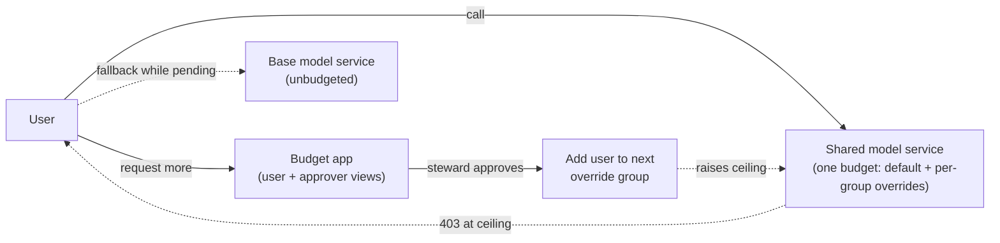
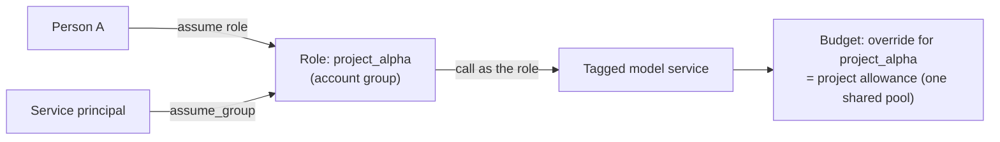

# Unity AI Gateway Budget Governance Kit

Two patterns for governing AI spend on Databricks **Unity AI Gateway** budgets:

1. **Tiered per-user budgets with governed elevation.** Everyone starts on a default
   per-user ceiling. A user who hits it asks for more in an app, a steward approves, and the
   user is moved to a higher tier. Ships as a Databricks App, a reconcile job, and Delta tables.
2. **Project-based budgets with RBAC roles.** Each project is an assumable role (an account
   group). Spend made under the role counts against the **project's** allowance, and that
   allowance is shared by everyone who assumes the role, separate from each person's own budget.
   This is configuration only: no app is needed.

Both rely on the gateway's native budget block (HTTP 403 at the ceiling). Nothing sits in the
request path, so model calls aren't slowed down.

## Which pattern do I need?

| You want to... | Use |
|---|---|
| Cap each person's spend, with an approval flow to raise it | [Tiered elevation](docs/TIERED_ELEVATION.md) |
| Give a project or team one pooled allowance that many people draw from | [Project budgets with RBAC](docs/PROJECT_BUDGETS_RBAC.md) |
| Keep someone's personal spend separate from their project spend | [Project budgets with RBAC](docs/PROJECT_BUDGETS_RBAC.md) |
| Both | They combine: the per-user default and tier overrides apply to calls made without a role; project overrides apply to calls made under a role |

## How it works

### 1. Tiered per-user elevation



- One model service and one budget with a default per-user limit plus higher limits for override
  groups (the highest applies).
- Elevation **adds** the user to the next override group through the account SCIM API, so
  nothing has to be removed to enforce a limit.
- An unbudgeted base service keeps people working while a request is pending.
- Full design, API list and runbook: [docs/TIERED_ELEVATION.md](docs/TIERED_ELEVATION.md) and
  [demo/README.md](demo/README.md).

### 2. Project budgets with RBAC roles



- Users and service principals get the **Assume** permission on the project group. They should
  **not** be members of it: membership turns the project's override into a personal ceiling.
- The gateway records the role as the caller (`requester` = the group, `requester_type` =
  `USER_GROUP`). The budget applies the role's override, and everyone who assumes the role
  shares one pool.
- The person behind each call is kept in `system.access.audit` (`run_by`).
- Setup, rules and validated results: [docs/PROJECT_BUDGETS_RBAC.md](docs/PROJECT_BUDGETS_RBAC.md).
  Monitoring queries: [sql/03_project_budget_queries.sql](sql/03_project_budget_queries.sql).

## Repository layout

| Path | What it is |
|---|---|
| `app/serve.py` | FastAPI Databricks App: role-aware UI plus JSON APIs (`/api/me`, `/api/usage`, `/api/request-elevation`, `/api/approvals`, ...) |
| `app/static/index.html` | Single-page UI with the user view and the approver view |
| `app/budget/` | Config loader, elevation state machine, account-group membership, Delta store, notifications, spend reader |
| `app/core/` | Account client, caller identity, system-table readers |
| `jobs/reconcile_tiers.py` | Scheduled backstop: notifies over-budget users and clears stale state |
| `config/tiers.example.yaml` | Configuration template (copy to `config/tiers.yaml`, which is gitignored) |
| `app.yaml` | Databricks Apps manifest |
| `sql/01_endpoint_and_budget.sql` | Model service, budget and override setup notes |
| `sql/02_approvals_audit.sql` | DDL for the kit's Delta tables |
| `sql/03_project_budget_queries.sql` | System-table queries for project budgets (spend per role, who acted as the role, billing) |
| `sql/04_usage_by_model.sql` | Per-user usage by model with estimated USD |
| `demo/` | Demo runbook and scripts (budget-aware client, cost generators) |
| `docs/` | Design write-ups for both patterns |
| `tests/` | Offline logic tests |

## Prerequisites

- A Databricks workspace with Unity AI Gateway and Unity Catalog.
- **Account admin** to create budgets and account groups (and, for pattern 1, the account
  service principal that manages override-group membership).
- **Workspace admin** to assign groups and service principals to the workspace.
- A catalog or schema where you can create model services and grant on them.
- For pattern 2: the **RBAC** preview turned on for the account and the workspace.
- Python 3.10+ and the Databricks CLI (OAuth login: `databricks auth login`).

## Quick start

### Pattern 1: tiered elevation app

Use an account profile (`<acct-profile>`) and a workspace profile (`<profile>`), both OAuth.

**1. Account groups (account console or `databricks account groups create`).** Keep access and
spend limits in separate groups:

| Group | Purpose | Gets |
|---|---|---|
| `<users-group>` | Who may use the kit | Workspace assignment, model access, app access (steps 4 and 7) |
| `<tier-2-group>`, `<tier-3-group>` | Higher spend limits only | Nothing but a budget override. Not assigned to the workspace, no grants; approvals fill them |
| `<stewards-group>` | Who may approve | Membership only; the app checks it |

Because tier groups carry no grants, an approval can only raise a spend limit, never widen access.

**2. Model services and tag.** Create a budgeted shared service and an unbudgeted base service
in `<catalog>.<schema>`, then tag only the shared one (for example `budget_kit_scope=tiered`):

```bash
databricks api post "/api/2.1/unity-catalog/model-services?parent=schemas/<catalog>.<schema>&model_service_id=<shared-service>" \
  --json '{"config":{"routing":{"destinations":[{"name":"primary","destination_type":"DESTINATION_TYPE_PAY_PER_TOKEN_FOUNDATION_MODEL","traffic_percentage":100,"pay_per_token_config":{"model":"models/system.ai.<model>"}}]}}}' -p <profile>
databricks api post /api/2.1/unity-catalog/entity-tag-assignments -p <profile> \
  --json '{"entity_type":"model-services","entity_name":"<catalog>.<schema>.<shared-service>","tag_key":"<tag-key>","tag_value":"<tag-value>"}'
```

Pick a tag no other budget filters on, and check that the new service has no tags that an
existing budget already matches.

**3. Budget (account level).** Unity AI Gateway budget filtered on the workspace and the tag:
a per-user alert with `BLOCK_USAGE` at the tier-1 amount, and `principal_overrides` for the
tier groups (their account group IDs). A `BLOCK_USAGE` action must not have a `target`.

**4. User access.** Assign `<users-group>` to the workspace with the **User** permission and the
**Consumer access** entitlement (`workspace-consume`). Grant it `USE CATALOG`, `USE SCHEMA` and
`EXECUTE` on both services. Onboarding a user is then a single step: add them to `<users-group>`.

**5. Account service principal for group membership.** Create an account SP, give it the
**Group manager** role on the tier groups only (not account admin), create an OAuth secret,
and store `account_sp_client_id` and `account_sp_client_secret` in a workspace secret scope.

**6. Tables.** Run `sql/02_approvals_audit.sql` with `{{catalog}}` and `{{schema}}` filled in.

**7. App.** Create the app with a SQL warehouse resource (`CAN_USE`), then grant the app's
service principal:

| On | Privileges |
|---|---|
| `<catalog>` / `<catalog>.<schema>` | `USE CATALOG` / `USE SCHEMA` |
| The four kit tables | `SELECT`, `MODIFY` |
| `system` / `system.ai_gateway` / `system.ai_gateway.usage` | `USE CATALOG` / `USE SCHEMA` / `SELECT` |
| The secret scope | `READ` |

Give `<users-group>` `CAN_USE` on the app. Fill in `config/tiers.yaml` (from
`config/tiers.example.yaml`) and the placeholders in `app.yaml`, then upload and deploy:

```bash
databricks workspace import-dir <local-dir> <workspace-path> --overwrite -p <profile>
databricks apps deploy <app-name> --source-code-path <workspace-path> -p <profile>
```

`config/tiers.yaml` is gitignored, and `databricks sync` skips gitignored files, so upload
with `import-dir` (or the deployed app has no config).

**8. Reconcile job (optional).** A serverless `spark_python_task` running
`jobs/reconcile_tiers.py` with `--warehouse-id`, `--config`, `--account-id`,
`--account-secret-scope` and `--account-host`. Create it paused for demos.

Then follow the end-to-end walkthrough in [demo/README.md](demo/README.md).

### Pattern 2: project budgets with RBAC

No code to deploy. Follow the setup steps in
[docs/PROJECT_BUDGETS_RBAC.md](docs/PROJECT_BUDGETS_RBAC.md):

1. Create an account group per project and assign it to the workspace.
2. Grant **Assume** on the group to the people or service principals who work on the project.
3. Grant the group `USE CATALOG`, `USE SCHEMA` and `EXECUTE` on the model service, and tag the
   service.
4. Create a budget filtered on that tag, with an override per project group.
5. Call as the role: `databricks auth login` and pick the role in the browser, or for a service
   principal add `assume_group=<group-id>` to its M2M token request.

## Configuration

All deployment-specific values live in `config/tiers.yaml` (gitignored) and `app.yaml`. Nothing
workspace-specific is committed. See [config/tiers.example.yaml](config/tiers.example.yaml)
for every field. Keep each tier's `threshold_usd` in sync with the budget's default and override
amounts.

## Tests

```bash
TIERS_CONFIG=config/tiers.example.yaml ./.venv/bin/python tests/test_escalation.py
```

## Disclaimer

- The codebase provided is intended to aid in getting started and may not be production-ready. The code does not have any guarantees/warantees/support. Use it at your own risk.
- This repo contains AI generated elements.
