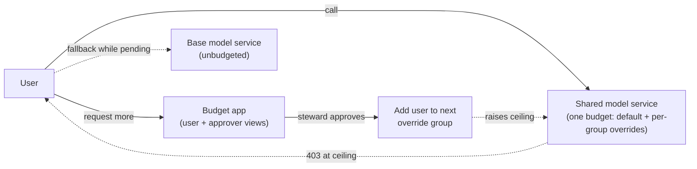
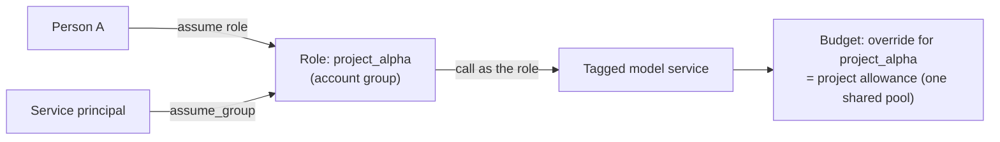

# Unity AI Gateway Budget Governance Kit

Two patterns for governing AI spend on Databricks **Unity AI Gateway** budgets:

1. **Tiered per-user budgets with governed elevation.** Everyone starts on a default
   per-user ceiling. A user who hits it asks for more in an app, a steward approves, and the
   user is moved to a higher tier. Ships as a Databricks App, a reconcile job, and Delta tables.
2. **Project-based budgets with RBAC roles.** Each project is an assumable role (an account
   group). Spend made under the role counts against the **project's** allowance, and that
   allowance is shared by everyone who assumes the role, separate from each person's own budget.
   This is configuration only: no app is needed.

Both rely on the gateway's native budget block (HTTP 403 at the ceiling). Nothing sits in the
request path, so model calls aren't slowed down.

## Which pattern do I need?

| You want to... | Use |
|---|---|
| Cap each person's spend, with an approval flow to raise it | [Tiered elevation](docs/TIERED_ELEVATION.md) |
| Give a project or team one pooled allowance that many people draw from | [Project budgets with RBAC](docs/PROJECT_BUDGETS_RBAC.md) |
| Keep someone's personal spend separate from their project spend | [Project budgets with RBAC](docs/PROJECT_BUDGETS_RBAC.md) |
| Both | They combine: the per-user default and tier overrides apply to calls made without a role; project overrides apply to calls made under a role |

## How it works

### 1. Tiered per-user elevation



- One model service and one budget with a default per-user limit plus higher limits for override
  groups (the highest applies).
- Elevation **adds** the user to the next override group through the account SCIM API, so
  nothing has to be removed to enforce a limit.
- An unbudgeted base service keeps people working while a request is pending.
- Full design, API list and runbook: [docs/TIERED_ELEVATION.md](docs/TIERED_ELEVATION.md) and
  [demo/README.md](demo/README.md).

### 2. Project budgets with RBAC roles



- Users and service principals get the **Assume** permission on the project group. They should
  **not** be members of it: membership turns the project's override into a personal ceiling.
- The gateway records the role as the caller (`requester` = the group, `requester_type` =
  `USER_GROUP`). The budget applies the role's override, and everyone who assumes the role
  shares one pool.
- The person behind each call is kept in `system.access.audit` (`run_by`).
- Setup, rules and validated results: [docs/PROJECT_BUDGETS_RBAC.md](docs/PROJECT_BUDGETS_RBAC.md).
  Monitoring queries: [sql/03_project_budget_queries.sql](sql/03_project_budget_queries.sql).

## Repository layout

| Path | What it is |
|---|---|
| `app/serve.py` | FastAPI Databricks App: role-aware UI plus JSON APIs (`/api/me`, `/api/usage`, `/api/request-elevation`, `/api/approvals`, ...) |
| `app/static/index.html` | Single-page UI with the user view and the approver view |
| `app/budget/` | Config loader, elevation state machine, account-group membership, Delta store, notifications, spend reader |
| `app/core/` | Account client, caller identity, system-table readers |
| `jobs/reconcile_tiers.py` | Scheduled backstop: notifies over-budget users and clears stale state |
| `config/tiers.example.yaml` | Configuration template (copy to `config/tiers.yaml`, which is gitignored) |
| `app.yaml` | Databricks Apps manifest |
| `sql/01_endpoint_and_budget.sql` | Model service, budget and override setup notes |
| `sql/02_approvals_audit.sql` | DDL for the kit's Delta tables |
| `sql/03_project_budget_queries.sql` | System-table queries for project budgets (spend per role, who acted as the role, billing) |
| `sql/04_usage_by_model.sql` | Per-user usage by model with estimated USD |
| `demo/` | Demo runbook and scripts (budget-aware client, cost generators) |
| `docs/` | Design write-ups for both patterns |
| `tests/` | Offline logic tests |

## Prerequisites

- A Databricks workspace with Unity AI Gateway and Unity Catalog.
- **Account admin** to create budgets and account groups (and, for pattern 1, the account
  service principal that manages override-group membership).
- **Workspace admin** to assign groups and service principals to the workspace.
- A catalog or schema where you can create model services and grant on them.
- For pattern 2: the **RBAC** preview turned on for the account and the workspace.
- Python 3.10+ and the Databricks CLI (OAuth login: `databricks auth login`).

## Quick start

### Pattern 1: tiered elevation app

```bash
python -m venv .venv && ./.venv/bin/pip install -r requirements.txt
cp config/tiers.example.yaml config/tiers.yaml      # fill in catalog, schema, groups, services
# fill in the placeholders in app.yaml (account id, app URL, secret scope)

# create the kit's Delta tables (sql/02_approvals_audit.sql), then deploy the app
databricks apps deploy <app-name> --source-code-path <workspace-path> -p <profile>
```

Then follow the end-to-end walkthrough in [demo/README.md](demo/README.md).

### Pattern 2: project budgets with RBAC

No code to deploy. Follow the setup steps in
[docs/PROJECT_BUDGETS_RBAC.md](docs/PROJECT_BUDGETS_RBAC.md):

1. Create an account group per project and assign it to the workspace.
2. Grant **Assume** on the group to the people or service principals who work on the project.
3. Grant the group `USE CATALOG`, `USE SCHEMA` and `EXECUTE` on the model service, and tag the
   service.
4. Create a budget filtered on that tag, with an override per project group.
5. Call as the role: `databricks auth login` and pick the role in the browser, or for a service
   principal add `assume_group=<group-id>` to its M2M token request.

## Configuration

All deployment-specific values live in `config/tiers.yaml` (gitignored) and `app.yaml`. Nothing
workspace-specific is committed. See [config/tiers.example.yaml](config/tiers.example.yaml)
for every field. Keep each tier's `threshold_usd` in sync with the budget's default and override
amounts.

## Tests

```bash
TIERS_CONFIG=config/tiers.example.yaml ./.venv/bin/python tests/test_escalation.py
```

## Things worth knowing

- **Budgets are near real time, not hard caps.** A small overspend can get through, and requests
  already running aren't stopped.
- **Budget tag filters match model-service tags only.** Request tags are useful for reporting but
  don't affect which budget applies.
- **Databricks-hosted pay-per-token models have no per-user USD system table.** Spend is derived
  from token counts in `system.ai_gateway.usage` multiplied by a price map.
- **Override groups must be account groups.** Unity Catalog grants only recognise account-level
  principals, so membership is managed through the account SCIM API.
- **Check each model service with a role before relying on it.** In testing, a service with a
  guardrail policy, rate limits and an inference table rejected role callers with
  `400 Invoker principal not found`, while a routing-only service worked.
- **System tables lag.** `system.ai_gateway.usage` trails by 20 minutes to a few hours, billing
  by longer. The 403 block is the only real-time signal.
