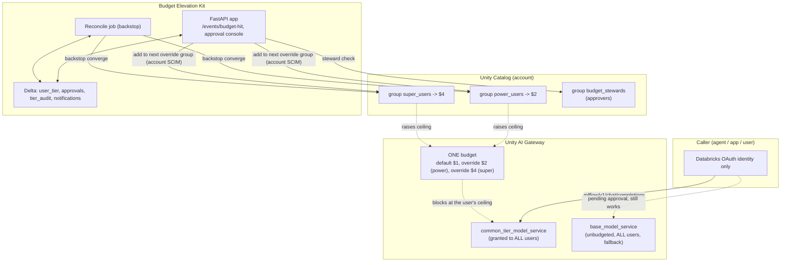
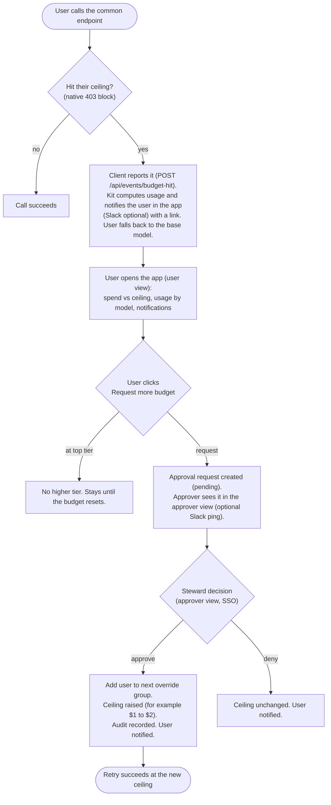

# UAG Tiered Budget Elevation Kit

Per-user AI spend tiers with a governed elevation workflow on Unity AI Gateway (UAG),
built on UAG per-group budget overrides.

A single UAG budget can carry a default per-user limit plus higher limits ("overrides")
for specific groups. If a user belongs to several override groups, the highest one applies.
This kit turns that into tiers: everyone shares one budgeted model endpoint, and "getting
more budget" means being added to the next override group, which raises that user's ceiling
on the same endpoint. A user who exhausts a tier is elevated through an approval, not simply
blocked.

Enforcement is the budget's native block (a hard 403 at the user's ceiling). Elevation is
add-only Unity Catalog account-group membership; the highest override a user holds wins, so
nothing is ever removed to enforce a limit. A separate, unbudgeted base endpoint granted to
everyone is the floor that keeps people working while a request is pending. Nothing sits in
the request path, so model calls are never slowed down.

Three tiers with escalating ceilings. Every elevation is user-initiated and steward-approved:
a user who hits their ceiling is notified in the app (with an optional Slack mirror), sees
their usage and a link, requests more budget, and a steward approves or denies. The user is
notified of the decision. The app has a user view and an approver view.

## How it works

| Layer | Mechanism | Owner |
|---|---|---|
| Effective ceiling | one UAG budget with a default limit plus per-group overrides; a 403 block fires at the user's ceiling | UAG (native) |
| Which tier you are in | UC account-group membership in the budget's override groups (highest applies) | Unity Catalog |
| Never fully cut off | a separate base endpoint (unbudgeted) granted to all users | Unity Catalog |
| Notify | on a block the user is notified in the app inbox (Slack mirror optional), with usage and a link | this kit |
| Elevation workflow | user requests in the app, a steward approves, the user is added to the next override group, and is notified of the decision | this kit |
| Self-healing | a scheduled reconcile job notifies over-budget users and clears stale state | this kit |

## Architecture



Key points:

- One endpoint, one budget. All users call `common_tier_model_service`; one budget scopes it
  with a default limit and per-group overrides.
- Add-only elevation. Elevation adds the user to the next override group; the highest override
  they hold is their ceiling, so nothing is removed to enforce.
- Account SCIM. Override groups are account groups (UC grants only recognize account-level
  principals), so membership is changed through the account API using a dedicated account
  service principal. Workspace SCIM is refused for account groups.

## Elevation flow (user-initiated, steward-approved)



There is no spend re-verification. The native block is the authoritative "you hit your
ceiling" event, and each higher tier is itself block-enforced, so approving only lets the
user reach the next capped ceiling.

## Two views (one app, role-aware)

The app decides the view on the client side from `/api/me` (`is_steward` is true for members
of the stewards group). Both are served from `app/static/index.html`:

- User view: spend vs ceiling (KPI tiles and a progress bar), usage by model, a notification
  inbox, a Request more budget button, and the user's request history.
- Approver view (stewards only): the pending-request queue with each requester's month-to-date
  spend and top models, plus Approve and Deny (with an optional reason). Approvers also keep
  their own user view.

JSON APIs: `/api/me`, `/api/usage`, `/api/notifications` (plus `/read`), `/api/requests`,
`/api/request-elevation`, `/api/approvals`, `/api/approvals/{id}`, `/api/events/budget-hit`.
Identity on every call is the verified `X-Forwarded-Email`.

## Example deployment values

The kit is config-driven. The names below are examples; put your own in `config/tiers.yaml`
(gitignored) and `app.yaml`.

| Thing | Example value |
|---|---|
| Shared endpoint | `internal_ai_services.shared.common_tier_model_service` (Claude Opus 4.8, all users) |
| Base endpoint | `internal_ai_services.shared.base_model_service` (unbudgeted, all users, fallback) |
| Budget | `ai_tier_budget`: default $1, override $2 (`power_users`), $4 (`super_users`) |
| Override groups | `power_users` (tier-2), `super_users` (tier-3) |
| Approver group | `budget_stewards` |
| Kit Delta tables | `internal_ai_services.budget_override.{user_tier, approvals, tier_audit, notifications}` |
| App | `uag-budget-governance-common` (FastAPI, binds `$DATABRICKS_APP_PORT`) |
| Account SP for SCIM | a dedicated account service principal, group-manager on the override groups |
| Reconcile job | `uag-budget-reconcile-common` |
| SQL warehouse | a small serverless warehouse |
| Secret scope | `uag-budget` (holds the account SP client id and secret) |
| Spend basis (reconcile) | `usage_tokens` times a price map, per tier, month to date |

Account id, workspace host, app URL, warehouse id, and service-principal client ids are
deployment-specific. Set them in `app.yaml` and `config/tiers.yaml`; do not commit them.

## Components

| Path | What it is |
|---|---|
| `app/serve.py` | FastAPI: role-aware UI plus JSON APIs (me, usage, notifications, requests, approvals, budget-hit) |
| `app/static/index.html` | the single-page UI (user view and approver view), vanilla JS |
| `app/budget/config.py` | config loader (tiers, per-tier override group, thresholds, stewards group, spend source) |
| `app/budget/escalation.py` | state machine: record budget hit, request, steward decision, add override group |
| `app/budget/groups.py` | account-SCIM membership add plus steward and tier `is_member` checks |
| `app/budget/approvals.py` | Delta store: approvals, tier_audit, user_tier, notifications inbox |
| `app/budget/notify.py` | `Notifier`: in-app inbox (always) plus Slack (optional, degrades to logging) |
| `app/budget/verifier.py` | per-tier spend read (reconcile backstop) |
| `app/core/account.py` | builds the account-scoped `AccountClient` from scope credentials |
| `app/core/systables.py` | system-table spend reader, per-model usage breakdown and cost |
| `app/core/auth.py` | verified caller identity (Databricks Apps `X-Forwarded-Email`) |
| `jobs/reconcile_tiers.py` | scheduled backstop (notify over-budget users, clear stale state) |
| `config/tiers.yaml` | the single configuration surface (see `tiers.example.yaml`) |
| `demo/elevating_client.py` | client that reports a 403 block to the app (no auto-elevate) |
| `demo/README.md` | end-to-end demo runbook |
| `sql/01_endpoint_and_budget.sql` | endpoint, budget, and override setup notes (account admin) |
| `sql/02_approvals_audit.sql` | Delta table DDL |
| `tests/test_escalation.py` | offline logic tests |

## Configuration (`config/tiers.yaml`)

```yaml
catalog: internal_ai_services
schema:  budget_override
spend:
  source: usage_tokens
  price_map: { "*opus*": { input: 8.20, output: 41.00 } }   # about $0.104/DBU, in-geo Opus
stewards_group: budget_stewards
tiers:
  - { name: tier-1, group: "",           service: ...common_tier_model_service, threshold_usd: 1, escalation: approval, notify: steward }
  - { name: tier-2, group: power_users,  service: ...common_tier_model_service, threshold_usd: 2, escalation: approval, notify: steward }
  - { name: tier-3, group: super_users,  service: ...common_tier_model_service, threshold_usd: 4, escalation: none,     notify: steward }
```

Keep `threshold_usd` in sync with the budget's default and override amounts so the kit's
detection matches the native block.

## Notes learned building this on a live workspace

- Per-group budget overrides let one budget carry a default plus higher per-group limits
  (highest applies). That is what lets one endpoint and one budget serve tiers, and it is the
  documented fix to UAG's earlier "uniform per-user only" limitation.
- The native budget block works and returns a clean 403 that names the budget, which makes it
  a good real-time elevation trigger (the client catches the 403).
- `external_model_spend` covers external (BYOK) providers only. Databricks-hosted pay-per-token
  foundation models are not in it, so there is no per-user USD system table for those. The only
  per-user signal is token counts in `system.ai_gateway.usage`, multiplied by a price map.
- Price-map calibration matters. PPT pricing is in DBU per 1M tokens, times your DBU rate.
  Measured here at roughly $0.104/DBU (a $6 block corresponded to about 57.6 DBU of Opus).
  This feeds only the reconcile backstop; the 403 trigger needs no spend math.
- Tier groups are account groups, so membership is managed through the account SCIM API with a
  dedicated account service principal. Workspace SCIM is refused for account groups.
- On Databricks Apps, bind the port to `$DATABRICKS_APP_PORT` (substituted at runtime), not a
  fixed number. A mismatch gives a persistent 502 even while the process is healthy.
- HTML form fields need FastAPI `Form(...)` (and `python-multipart`). Read as plain params they
  arrive empty and silently deny every approval.
- Notifications are in-app by default; Slack is an optional, admin-gated mirror. The `Notifier`
  always writes the in-app inbox and posts to Slack only when a bot token and channels are set,
  otherwise it logs. Enabling Slack needs admin action (a Slack app or bot token, or a Workflow
  Builder webhook trigger). The managed `system.ai.slack` MCP is read-only, so it cannot send.

## Operate

- Run the demo: see `demo/README.md`.
- Approve or deny: open the app root (SSO), pending requests, review, Approve or Deny (stewards
  only).
- Audit trail: `SELECT * FROM internal_ai_services.budget_override.tier_audit ORDER BY changed_at DESC`.
- Change thresholds: update the budget's default and override amounts and the `threshold_usd`
  values in `config/tiers.yaml`, then redeploy.
- Pause or resume automation: pause or unpause the reconcile job schedule.
